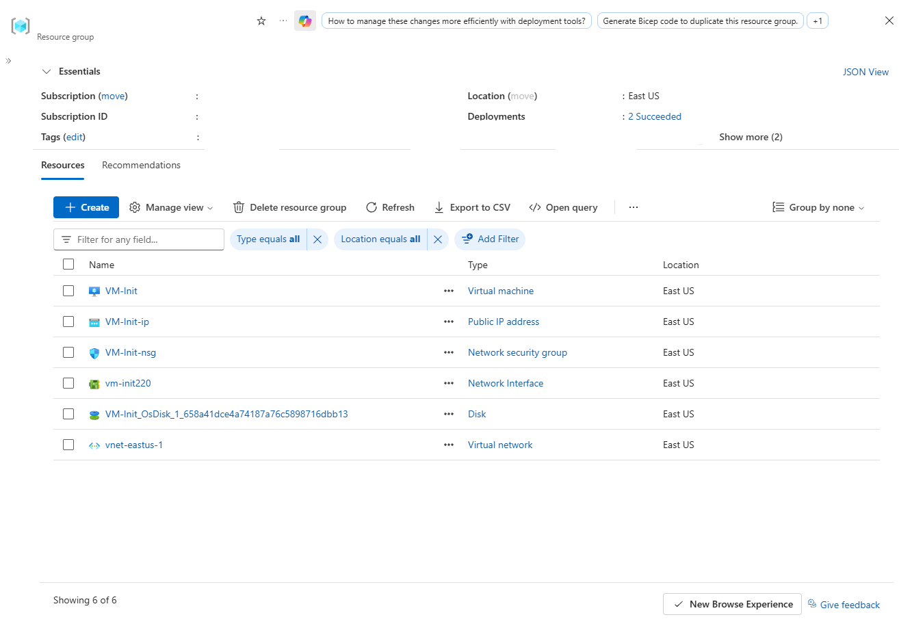
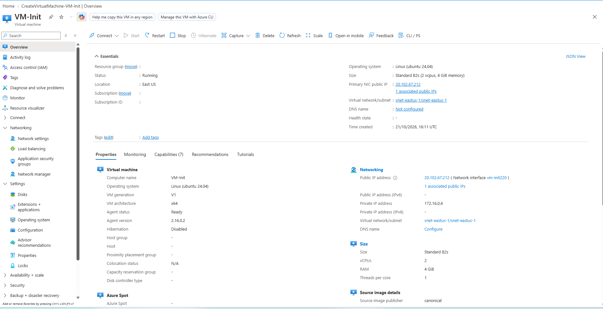
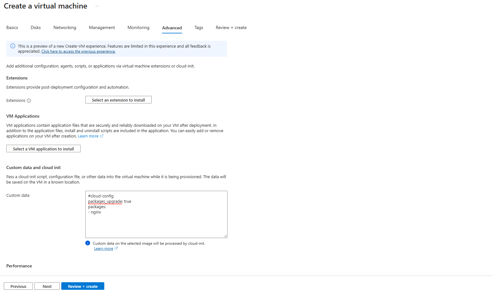
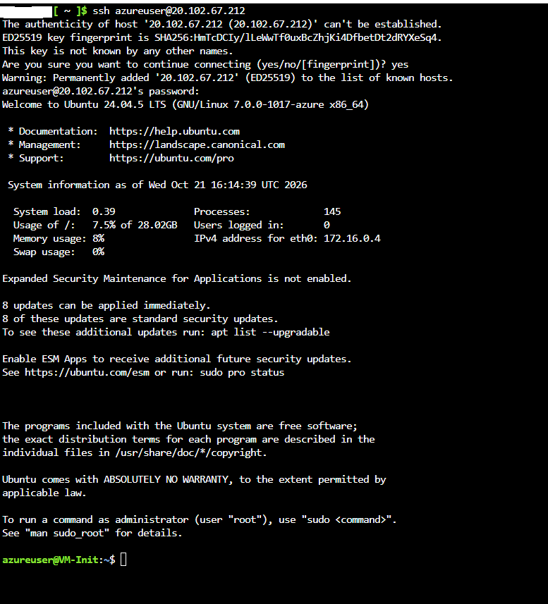
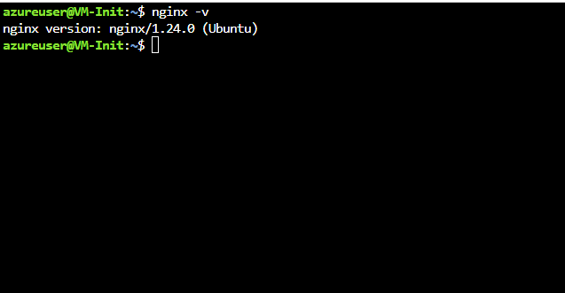

# Automating NGINX Deployment on Azure Linux Virtual Machines with Cloud-Init

Comprehensive laboratory infrastructure deployment demonstrating automated package upgrades and NGINX web server installation on an Ubuntu Linux virtual machine during initial provisioning using cloud-init custom data.

---

## 1. Architecture & Provisioned Resources

### Core Infrastructure Topology

| Resource Type | Resource Name | Specification / Tier | Region / Location |
| :--- | :--- | :--- | :--- |
| **Virtual Machine** | `VM-Init` | Standard_B2s, Ubuntu 24.04 LTS (x64 Gen1) | East US |
| **Virtual Network** | `vnet-eastus-1` | `172.16.0.0/16` (`snet-eastus-1`: `172.16.0.0/24`) | East US |
| **Public IP Address** | `VM-Init-ip` | Static Standard IPv4 (`20.102.67.212`) | East US |
| **Network Security Group** | `VM-Init-nsg` | Associated with `vm-init220` NIC | East US |
| **Network Interface** | `vm-init220` | Dynamic Private IP (`172.16.0.4`) | East US |
| **OS Disk** | `VM-Init_OsDisk_1...` | 30 GB, Standard SSD LRS | East US |

---

### Provisioned Environment Validation

*Resource group overview confirming successful provisioning of the virtual machine, public IP address, network security group, network interface, OS disk, and virtual network.*

---

*Virtual machine overview pane showing VM-Init running Ubuntu 24.04 LTS with primary public IP address 20.102.67.212.*

---

## 2. Step-by-Step Implementation

### Step 1: Configure Cloud-Init Script in Custom Data

Passed the cloud-config directive into the Advanced VM deployment configuration to automatically update existing packages and install the NGINX web server upon first boot.

*Custom data field specifying package upgrade and NGINX installation directive via cloud-config.*

---

### Step 2: Establish SSH Session to Provisioned Virtual Machine

Connected to `VM-Init` via SSH using the assigned public IP address (`20.102.67.212`) to verify initial environment availability.

*SSH connection terminal output confirming successful authentication to VM-Init running Ubuntu 24.04.5 LTS.*

---

### Step 3: Verify Automated NGINX Web Server Installation

Executed the `nginx -v` command within the SSH session to confirm that cloud-init successfully installed NGINX during the virtual machine initialization process.

*Terminal output showing installed NGINX version 1.24.0 on the provisioned Ubuntu virtual machine.*
